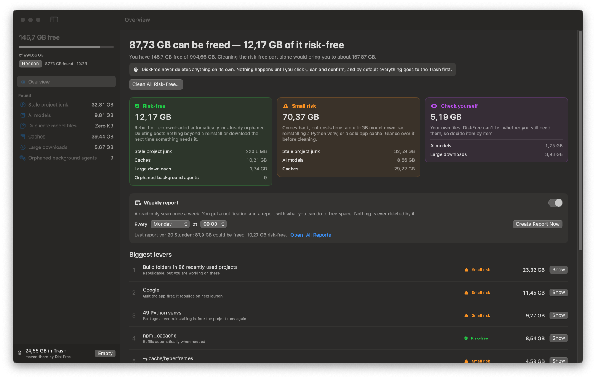

<div align="center">


# DiskFree

**Find out what's eating your Mac's disk — and decide what to get back.**

DiskFree scans for rebuildable build folders, forgotten AI models, package caches and old installers,<br>
rates every item by risk, and only ever deletes after you click and confirm.


<br>



</div>

> [!CAUTION]
> **Use DiskFree at your own risk.** It deletes files, and it is not perfect: its risk ratings are heuristics and can
> be wrong for your setup. **Don't use it if you don't understand what it is about to delete.** Check every item before
> you clean, keep a current backup (e.g. Time Machine), and prefer *Move to Trash* over *Delete Permanently*.
> The author accepts **no liability** for lost data or any other damage. See the [Disclaimer](#disclaimer).

---

## Why

Developer and AI machines fill up in ways Finder doesn't show you: hundreds of `node_modules` folders in projects you
haven't opened in months, Python venvs, a Hugging Face cache full of models you deleted long ago, 20 GB of `uv` and
`npm` caches, installers sitting in Downloads. On the Mac this was built for, DiskFree found **over 200 GB** — most of
it risk-free to remove — and took the disk from 30 GB to 150 GB free in an afternoon.

## Features

- **🛡 Risk rating for everything.** Each item is *Risk-free*, *Small risk* or *Check yourself*, with a one-line
  reason ("Rebuilt by npm install", "Re-downloads on next use (9.3 GB)", "Your file — may not exist anywhere else").
  Only risk-free items are preselected.
- **📊 Biggest levers first.** The Overview ranks the largest wins so you know where the space actually is.
- **🧹 One click for the safe part.** *Clean All Risk-Free…* handles everything that comes back on its own, after a
  confirmation that shows exactly how much will go.
- **🧬 Duplicate models become APFS clones.** Byte-identical model files stored twice are replaced by a clone of the
  other copy: every path keeps working, the data is stored once. Files are compared byte for byte first.
- **🗑 Trash first.** Cleaning moves things to the Trash by default. *Empty* in the sidebar deletes only what DiskFree
  put there — the rest of your Trash is never touched.
- **📅 Weekly report.** Optionally runs a read-only scan once a week and sends a notification plus a Markdown report:
  free space and change since last week, what you can do, and the biggest levers.
- **🔎 Menu-bar readout.** Free space is always visible in the menu bar.

## What it looks at

| Category | What | Typical risk |
|---|---|---|
| **Stale project junk** | `node_modules`, Python venvs, SwiftPM `.build`, Rust `target`, `.next`, `.nuxt`, `.turbo`, CocoaPods | Risk-free if the project is untouched for 90+ days (adjustable); venvs and active projects are *small risk* |
| **AI models** | Hugging Face models and datasets (including orphaned files in the shared blob pool), LM Studio, Whisper, big model files in projects | Small risk (re-download), orphans risk-free |
| **Duplicate model files** | Identical `.safetensors`, `.gguf`, `.bin`, … stored more than once | Risk-free (replaced by APFS clones) |
| **Caches** | `~/.cache`, `~/Library/Caches`, npm, pnpm, uv, pip, Homebrew, Playwright, Xcode DerivedData | Package caches risk-free; app caches small risk (quit the app first) |
| **Large downloads** | Anything over 200 MB in Downloads | Installers risk-free; everything else *check yourself* |
| **Orphaned background agents** | Login agents whose program no longer exists | Risk-free |

**Never scanned:** `~/Library` (apart from caches), Applications, Photos, Music, Movies, and cloud-synced folders
(iCloud Drive, Dropbox, Google Drive, OneDrive) — deleting there would delete on every device.

---

## Install

> [!WARNING]
> Before installing, read the [caution note](#diskfree) at the top and the [Disclaimer](#disclaimer). If you're not
> sure what a `node_modules` folder, a Python venv or a model cache is, ask someone who does before cleaning anything.

### Option A — download the app (no developer tools needed)

1. Open the [**Releases**](../../releases/latest) page and download **`DiskFree-x.y.z.zip`**.
   *(The repository is private: you need to be added as a collaborator to see it, or ask for the zip directly.)*
2. Double-click the zip and drag **DiskFree.app** into your **Applications** folder.
3. **First launch.** DiskFree isn't notarized by Apple, so macOS blocks it the first time:
   - Double-click DiskFree, click **Done** in the warning.
   - Open **System Settings → Privacy & Security**, scroll down to *"DiskFree was blocked…"* and click
     **Open Anyway**, then confirm with your password.

   <details>
   <summary>Or do it in Terminal</summary>

   ```bash
   xattr -dr com.apple.quarantine /Applications/DiskFree.app
   open /Applications/DiskFree.app
   ```
   </details>
4. When macOS asks whether DiskFree may access your **Desktop**, **Documents** and **Downloads**, click **Allow** —
   that's where your projects and downloads are. The scan only reads.

### Option B — build from source

Needs macOS 14+ and Apple's free Command Line Tools (`xcode-select --install`). No Xcode, no dependencies.

```bash
git clone https://github.com/jenstools/diskfree.git
cd diskfree
./build.sh --install        # builds, copies to /Applications and opens it
```

| Command | Does |
|---|---|
| `./build.sh` | Builds `.build/DiskFree.app` |
| `./build.sh --install` | Builds, installs to `/Applications`, launches |
| `./build.sh --report` | Prints what a scan finds in the terminal — touches nothing |
| `./build.sh --release` | Universal (Apple Silicon + Intel) app, zipped into `dist/` |

---

## Using it

1. DiskFree scans on launch (about 30–60 seconds) and opens the **Overview**.
2. Look at the three risk cards and the **Biggest levers**. *Show* jumps to the matching list.
3. Either click **Clean All Risk-Free…**, or open a category, tick what you want and click **Clean…**.
   Choose **Move to Trash** (default) or **Delete Permanently**.
4. Moving to the Trash frees no space until it's emptied — use **Empty** at the bottom of the sidebar to delete just
   DiskFree's items.

**Weekly report:** switch it on in the *Weekly report* card on the Overview and pick a day and time. If the Mac is
asleep at that moment, it runs at the next wake. Reports are kept in
`~/Library/Application Support/DiskFree/Reports/` (the last 12).

## Safety

- Nothing is deleted without your click **and** a confirmation dialog.
- Default action is *Move to Trash*; "Empty" only removes items DiskFree moved there.
- Duplicate replacement verifies the files are byte-identical and swaps atomically; on any error the original stays.
- Cloud-synced folders and system locations are excluded from the scan.
- The weekly report only scans. It has no code path that deletes.
- No network access, no analytics, no accounts.

## Uninstall

1. In DiskFree, switch off the **Weekly report** (removes its login agent).
2. Quit DiskFree and drag it from Applications to the Trash.
3. Optional cleanup:

```bash
rm -rf ~/Library/Application\ Support/DiskFree
defaults delete com.jenspolomski.diskfree
```

## Disclaimer

DiskFree is a personal tool shared as is, **without any warranty**, express or implied — including fitness for a
particular purpose. It is not a commercial product and has not been tested on anything but a handful of Macs.

- It moves files to the Trash and, if you choose so, **deletes them permanently**. Deleted data may not be recoverable.
- The categories and risk ratings ("Risk-free", "Small risk", "Check yourself") are **best guesses** based on folder
  names, locations and dates. A folder rated risk-free can still matter to you — for example a venv you can't
  rebuild, a model you can't download again, or files that only look like a cache.
- You alone decide what gets cleaned. **Review every item, keep backups, and use it only if you understand what it
  does.**
- **The author is not liable** for any loss of data, broken projects, lost time or any other damage resulting from
  using, or being unable to use, this software.

By using DiskFree you accept these terms.

<details>
<summary><b>Project layout</b></summary>

```
Sources/DiskFree/
  DiskFreeApp.swift     App entry, menu-bar item, --report / --weekly-report modes
  Model.swift           Categories, risk levels and the scanned item type
  Scanner.swift         Read-only scan of projects, models, caches, downloads, launch agents
  FileSystem.swift      fts traversal, sizes, APFS private size, sampled + full file comparison
  Assessment.swift      Risk rating, reasons and biggest levers (shared by window and report)
  Store.swift           App state and every disk-changing operation (Trash, delete, clone, unload)
  WeeklyReport.swift    Weekly Markdown report, notification and its login agent
  Views.swift           SwiftUI: Overview, category tables, Trash footer
Resources/
  Info.plist, AppIcon.icns, make-icon.swift (renders the icon)
build.sh                Build, install and release script
```
</details>
